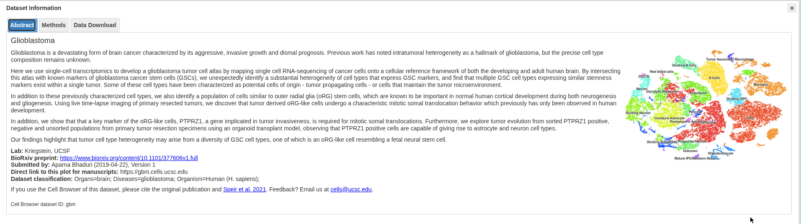
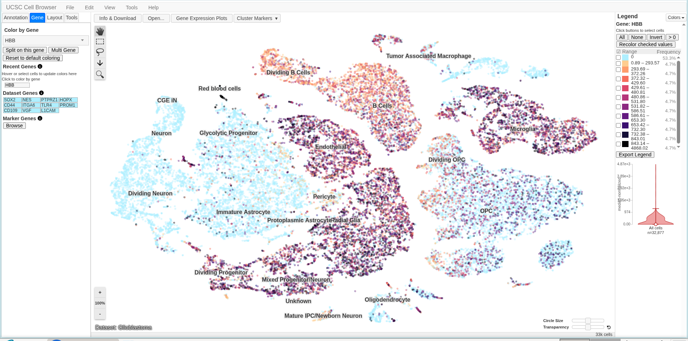
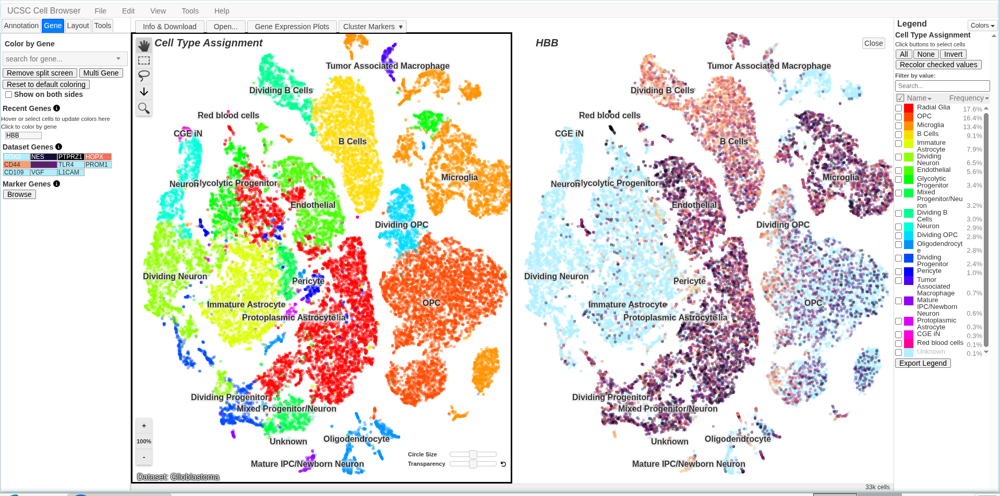
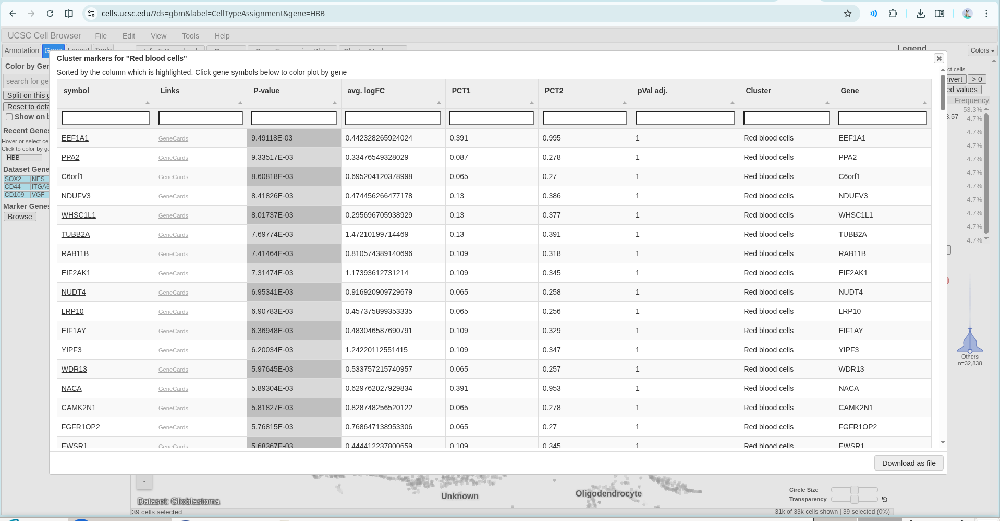
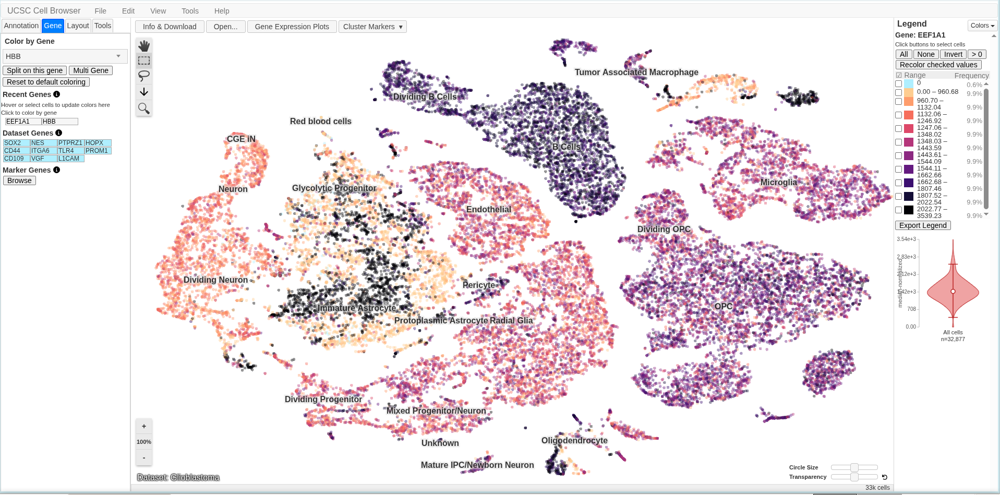

# From Genome to Cell: Exploring Disease Gene Using the UCSC Cell Browser
This activity uses the UCSC Cell Browser to study human HBB gene expression in single cells. It focuses on exploring a tissue dataset, viewing cell clusters, mapping where HBB is active, and comparing its expression pattern to standard marker genes.

---
# I. UCSC Cell Browser Activity
**Name:** Richelle O. Gregorio  
**Student Number:** 202400734  
* **Assigned Gene:** *HBB* (Hemoglobin Subunit Beta)  
* **Associated Disease:** Sickle Cell Disease (SCD)

Using the same assigned gene (*HBB*) from our previous lab, this activity uses the UCSC Cell Browser to look at *HBB* expression in individual cells and see which cell types or clusters it shows up in.

---
## II. Organ/Tissue Choice and Dataset Information

- **Dataset Name:** Glioblastoma (Cell Browser Dataset ID: `gbm`)
- **Organ/Tissue:** Brain / Human Brain Tumor Tissue (Organs: brain; Diseases: glioblastoma)
- **Organism:** Human (*Homo sapiens*)
- **Lab / Submission:** Kriegstein Lab, UCSF (Submitted by Aparna Bhaduri, 2019-04-22, Version 1)
- **Citation:** BioRxiv preprint (https://www.biorxiv.org/content/10.1101/377606v1.full) / Speir et al., 2021
- **Dataset URL:** [UCSC Cell Browser - Glioblastoma Dataset](https://cells.ucsc.edu/?ds=gbm&label=CellTypeAssignment)

### Why This Dataset Was Selected

Mature red blood cells lose their nuclei and active mRNA, so they cannot be analyzed directly using standard single-cell RNA sequencing. The Glioblastoma dataset was chosen as a surrogate tissue model because its microvascular network retains intact red blood cell precursors within the tumor microenvironment in which enables the visualization of lineage-restricted *HBB* expression across specific cell clusters on the UMAP plot.

***Figure 1.** Selected UCSC Cell Browser Glioblastoma dataset (`gbm`) metadata and cell type cluster map.*

---
## III. Understand The Cell Map
- **A. Visualization Type:** UMAP (Uniform Manifold Approximation and Projection)
- **B. Representation of a Single Dot:** Each dot represents one single measured cell from the glioblastoma tissue sample.
- **C. Meaning of Clusters:** In this dataset, the clusters represent distinct cell types and functional states within the tumor microenvironment (such as cancer stem cells, neural lineages, and vascular/immune cell populations).
- **D. Visible Cell-Type Labels:** 
  - Red Blood Cells
  - Microglia
  - B Cells

 ---
 ## IV. Assigned Gene Expression
- **Assigned Gene Symbol:** `HBB`
- **Dataset Used:** Glioblastoma (`gbm`)
- **Is expression widespread, restricted, or low/undetected?**: Restricted. Instead of spreading across the entire tumor, expression shows up only in specific cell populations.
- **Which cluster(s) appear to contain cells with stronger expression?**: High expression is concentrated in the Red blood cells cluster, with smaller signals present in surrounding microvascular cell lineages like Endothelial cells.
- **Which cluster(s) appear to contain little or no detectable expression?**: Most tumor and brain cell types—including Neuron, Dividing Neuron, Immature Astrocyte, Protoplasmic Astrocyte/Radial Glia, OPC, Microglia, and Tumor Associated Macrophage show no detectable *HBB* expression.

***Figure 2.** Single-cell UMAP plot of the Glioblastoma dataset (`gbm`) recolored by HBB gene expression.*

The UMAP plot shows that *HBB* expression is highly restricted rather than widespread. High expression levels are concentrated specifically in the Red blood cells cluster and vascular components like Endothelial cells. In contrast, neural progenitors, astrocytes, microglia, and primary tumor cell types remain completely uncolored, proving that *HBB* functions strictly as an erythroid lineage marker within this tissue sample.

---
## V. Identify the Cell Types Expressing Your Gene
In this section, we compare the *HBB* gene expression heatmap directly against the annotated cell-type map. By cross-referencing cell clusters with their expression signals, we can locate which specific cell populations actively express *HBB* and which show no activity.

- **Cell type/cluster with the strongest visible expression:** Red blood cells cluster.
- **Another cell type/cluster with detectable expression:** Endothelial cluster
- **Cell type/cluster with relatively low or undetected expression:** Major brain and tumor lineages which includes Radial Glia,OPC,Microglia, and Neuron clusters—show virtually no detectable expression.
- **Is the expression pattern broad or cell-type restricted?** Strictly cell-type restricted.
- **Biological Explanation:**
  In this glioblastoma dataset, the *HBB* expression is tightly restricted because hemoglobin subunit beta is naturally produced by red blood cells rather than native brain tissue. The detected expression comes from intact erythroid precursors trapped within the tumor’s microvascular network. Since glioblastoma cells, neurons, and glial lineages do not express hemoglobin genes under standard conditions, signal remains confined exclusively to red blood cells and vascular elements in the sample.

***Figure 3.** Side-by-side split screen view of the Glioblastoma dataset showing Cell Type Assignment annotations on the left alongside HBB gene expression mapping on the right.*

Comparing the annotation map directly to the gene expression map confirms that *HBB* isn't randomly scattered across the tumor mass. High expression aligns directly with the Red blood cells cluster and adjacent Endothelial cells, while all primary brain tumor lineages remain completely uncolored. This demonstrates clear lineage-specific expression within the sample.

---
## VI. Select Cells and Examine a Violin Plot
While 2D UMAP plots give us a spatial perception of where a gene lights up, they can hide actual expression levels and data density. Isolating specific cells with the selection tool allows us to directly compare mRNA expression levels between our targeted group and the surrounding tissue using a quantitative violin plot.

- **Which cells/cluster did you select?** 
  **Red blood cells** cluster

- **Does your selected group show higher, lower, or similar expression compared with the comparison cells?** 
  The selected red blood cell cluster shows drastically higher expression levels compared to the background population. The violin shape for the selected cells extends high up the vertical axis, while the comparison group remains flat near zero.

- **What does the expression plot add that was not obvious from the UMAP/t-SNE map?** 
  The UMAP map only shows dot placement, which can obscure whether expression is weak or strong. The violin plot provides actual statistical proof: it shows the full range, shape, and concentration of *HBB* transcript levels, confirming that expression in these cells is intense and real rather than low-level background noise and additionally, the **dot plot** complements this by providing a multi-gene comparative summary across every cell type, simultaneously displaying both the percentage of expressing cells (dot size) and their average expression level (dot color). This clearly demonstrates that while stemness markers like *SOX2* are broadly distributed, *HBB* is strictly localized with high expression in erythroid cells.

.png)
_**Figure 4.** (Violin Plot): UCSC Cell Browser violin plot displaying the quantitative distribution and range of HBB expression levels in selected red blood cells_.

The violin plot shows a noticeable change of the expression gap between the isolated red blood cell cluster and the rest of the sample. The wide, tall violin distribution for the selected cells confirms active, high-level transcript production. In contrast, the comparison violin representing all background cells stays completely flat at near zero, proving that *HBB* expression is statistically exclusive to this small target population rather than being spread across the broader glioblastoma tissue.

---
.png)
__**Figure 4.1_(Dot Plot).** UCSC Cell Browser dot plot comparing the expression frequency (dot size) and mean intensity (color shade) of HBB against neural stemness markers across all annotated glioblastoma cell clusters._

The dot plot provides a comprehensive multi-gene overview across every annotated cell type in the dataset. By mapping dot size (percentage of expressing cells) and color intensity (mean expression level), it highlights how *HBB* remains strictly restricted to the Red blood cells cluster with high intensity, while showing virtually zero presence across nearly all neural, glial, and tumor core populations. Meanwhile, standard marker genes like `SOX2`, `PTPRZ1`, and `HOPX` show broad, continuous expression across various brain and progenitor cell types that clearly shows the functional difference between a tissue-specific microenvironment gene and native cell-state markers.

---
## VII. Examine Cluster Markers
To get a clearer picture of how cell identities are defined computationally, the cluster markers table for the specific cluster where the gene appears was inspected. This table ranks genes based on how uniquely or strongly they are expressed in that group compared to the rest of the sample.

- **Which cluster's marker genes did you inspect?**
  The **Red blood cells** cluster.

- **What are some of the top marker genes listed for this cluster?**
  Some of the top marker genes showed in the table include `EEF1A1`, `PPA2`, `C6orf1`, `NDUFV3`, `WHSC1L1`, `TUBB2A`, `RAB11B`, and `EIF2AK1`.
  
- **Is your assigned gene listed among the top markers? Explain why it might or might not be present.**
  *HBB*, my assigned gene does not appear in the top rows of this specific table view. Even though *HBB* is heavily expressed in these cells, automated marker ranking relies on a combination of adjusted p-values, log fold-changes and the ratio of expression frequency inside versus outside the cluster. Because the red blood cell cluster makes up a tiny fraction of this glioblastoma dataset a highly abundant ribosomal or housekeeping genes (such as `EEF1A1` or `TUBB2A`) often score higher statistically in general automated tables even though *HBB* remains the defining biological gene for the lineage.

_**Figure 5.** UCSC Cell Browser cluster markers table displaying the top differential genes calculated for the Red blood cells cluster in the Glioblastoma dataset._

The cluster markers table provides information about the statistical scoring behind cell identification. It demonstrates that while broad highly expressed genes like `EEF1A1` and `TUBB2A` rank at the top based on p-value and fold-change. fully understanding a cell population requires looking beyond just the top statistical list and considering biologically distinct genes like *HBB*.

---
## VIII. Compare Assigned Gene With One Marker Gene

- **Assigned disease gene:** `HBB`
- **Marker gene:** `EEF1A1` (selected from the top cluster markers of the Red blood cells cluster)
- **Which gene shows a more cell-type-restricted expression pattern?** 
  `HBB` shows a strictly cell-type-restricted pattern, almost exclusively within the **Red blood cells** cluster and isolated vascular elements

- **Which gene appears more broadly expressed?** 
  `EEF1A1` is expressed extremely broadly across nearly every single cell cluster in the entire glioblastoma UMAP layout.

- **What does this comparison teach you about the difference between a disease-associated gene and a cell-type marker gene?** 
  This comparison demonstrates the clear biological distinction between a lineage-restricted functional gene and a broad housekeeping/translational marker gene. A disease-associated gene like *HBB* carries out a highly specialized physiological role (oxygen transport in erythroid cells), keeping its transcription tightly confined to a specific cell lineage. Conversely, top statistically ranked cluster marker genes like `EEF1A1` drives the universal core cellular processes like protein synthesis and because `EEF1A1` is active in virtually in all viable, metabolically active cells across tumor and brain populations it displays continuous, widespread expression across the map rather than strict lineage restriction.

_**Figure 6.** UCSC Cell Browser UMAP plot displaying the widespread single-cell expression of the EEF1A1 marker gene across all annotated clusters in the Glioblastoma dataset._

The `EEF1A1` UMAP plot shows a clear contrast to the isolated expression pattern seen with *HBB*. While *HBB* signal stays confined to a tiny group of 39 red blood cells, `EEF1A1` shows up strongly across almost the entire sample—including neural progenitors, astrocytes, microglia, neurons, and tumor populations.

---
HBB and EEF1A1 show completely different expression patterns in the glioblastoma dataset. As a specialized gene for oxygen transport, HBB is tightly restricted to a small 39-cell red blood cell cluster. In contrast, EEF1A1 is a housekeeping gene involved in protein synthesis that is widely and abundantly expressed across nearly every cell in the sample. This demonstrates how single-cell analysis separates tissue-specific functional genes from ubiquitous metabolic markers.

---
## IX. Connect the Cell Browser Result to Your Previous Genome Activity

To bridge sequence-level genomic architecture with single-cell tissue expression, the structural findings from the previous *HBB* mutation repository (`richellegregorio1920/Gregorio-SickleCell-HBB-mutation-lab`) were connected directly to the output observed in the glioblastoma cell map.

- **1. On which chromosome is your assigned gene located?**
  *HBB* is located on the short arm of chromosome 11, specifically positioned at cytogenetic band **11p15.5**.

- **2. What disease-associated variant did you examine previously?**
  The pathogenic missense mutation responsible for Sickle Cell Disease—specifically the **HbS allele (rs334, p.Glu6Val)**, where a single nucleotide substitution (GAG to GTG) swaps a hydrophilic glutamic acid for a hydrophobic valine at position 6 of the beta-globin polypeptide chain.

- **3. In the current Cell Browser dataset, which cell type(s) express the gene?**
  *HBB* expression is detected almost exclusively within the **Red blood cells** cluster with faint trace levels extending into associated vascular elements like **Endothelial** cells.
  
- **4. Does the observed cell expression make biological sense based on what you already know about the gene's function or associated disease? Explain in 3-5 sentences.**
  Yes, the observed expression pattern makes complete biological sense because *HBB* encodes the beta-globin subunit of hemoglobin, which carries out systemic oxygen transport within erythroid cells. Even though this dataset samples glioblastoma brain tissue rather than bone marrow or peripheral blood, tumors rely on dense vascular networks to support rapid growth. The *HBB* transcripts captured here simply represent mature and developing red blood cells circulating through or trapped inside the tumor's microvessels during tissue dissociation. Therefore, the data cleanly reflects normal erythroid lineage biology rather than active transcription by native brain cells or glioblastoma tumor progenitors.

- **5. Can this single Cell Browser dataset prove that the gene causes the disease? Explain why or why not.**
  No, a single single-cell transcriptomics dataset cannot prove that *HBB* causes Sickle Cell Disease. Single-cell RNA sequencing only measures steady-state mRNA abundance within individual cells at a specific snapshot in time, where a gene is transcribed rather than how structural alterations in the gene product cause pathology. To establish disease causation, expression data must be combined with genetic sequencing, structural biochemistry showing protein sickling under deoxygenation and clinical studies linking the p.Glu6Val variant directly to red blood cell distortion and vaso-occlusion.

---
## X. Short Reflection

- **1. What did the UCSC Cell Browser show you that the UCSC Genome Browser could not?**
  The UCSC Cell Browser showed me how *HBB* expression differs among individual cell types, especially its concentration within the Red blood cells cluster. In comparison, the UCSC Genome Browser helped me examine the genomic location, exon-intron structure, and variant position (p.Glu6Val) of *HBB*. Using both browsers allowed me to view the gene from both a structural genomic perspective and a living cellular context.

- **2. Why can the same gene have different expression levels among different cell types?**
  The same gene can have different expression levels because different cell types perform specialized functions and do not need to transcribe every gene at equal levels. A gene like *HBB* is expressed heavily in erythroid lineages where oxygen transport is essential, while being expressed at low levels or completely silenced in neural and glial cells where beta-globin serves no functional purpose.

- **3. Why should you be careful when interpreting a gene that shows zero or very low expression in single-cell data?**
  Zero or very low expression in single-cell data does not always mean that the gene is completely absent or inactive in that cell type. Technical limitations such as RNA dropouts or low capture efficiency can cause active transcripts to be missed during sequencing. Therefore, low or zero values should be interpreted carefully as "undetected in this specific snapshot" rather than immediately concluding the gene is never expressed.

- **4. Why is it useful to combine information about genomic location, genetic variants, and cell-specific gene expression?**
  Combining these types of information gives a more complete understanding of a disease-associated gene. Genomic information shows where *HBB* and its pathogenic variant (HbS) are located at the sequence level, while cell-specific expression helps identify the precise cell types where the gene is active. Together, these tools connect the primary DNA mutation directly to its tissue-level and physiological consequences.

- **5. What was the most interesting observation you made about your assigned gene?**
  What intrigued me most was seeing *HBB* expression pop up strongly inside a glioblastoma brain tissue dataset, strictly localized to a tiny cluster of 39 red blood cells. It was amazing to see how single-cell transcriptomics can clearly separate circulating microvascular blood cells trapped inside tumor vessels from the surrounding brain tissue, making the connection between the gene, its erythroid lineage, and the tumor's blood supply much easier to understand.

---
# Reference Links for HBB Lab Report

## Project & Code Repository
- Previous Lab Repository: https://github.com/richellegregorio1920/Gregorio-SickleCell-HBB-mutation-lab

## UCSC Platforms & Datasets
- UCSC Cell Browser Main Portal: https://cells.ucsc.edu/
- UCSC Cell Browser (Glioblastoma Datasets): https://cells.ucsc.edu/?ds=gbm-nvp
- UCSC Genome Browser (HBB Gene Entry): https://genome.ucsc.edu/cgi-bin/hgGene?db=hg38&hgg_gene=HBB

## Biological & Database References
- NCBI Gene Portal (HBB - Gene ID 3043): https://www.ncbi.nlm.nih.gov/gene/3043
- NCBI ClinVar (HBB HbS Variant / rs334): https://www.ncbi.nlm.nih.gov/clinvar/variation/15286/
- UniProtKB Entry (HBB - P68871): https://www.uniprot.org/uniprotkb/P68871/entry
- Human Protein Atlas (HBB Entry): https://www.proteinatlas.org/ENSG00000244734-HBB

 
